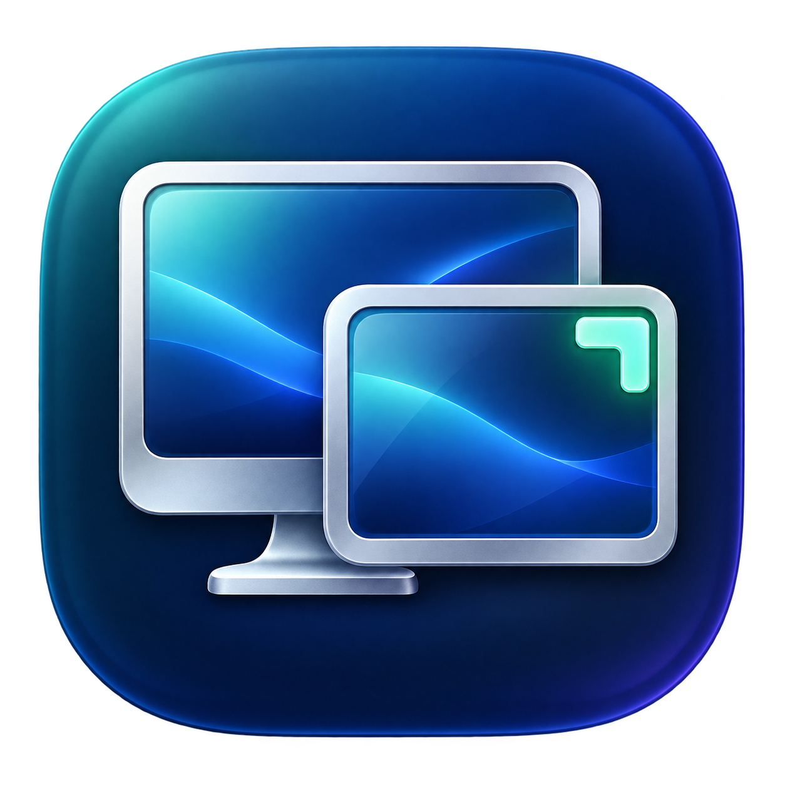

<p align="center">
  
</p>

<h1 align="center">ScreenMate</h1>
<p align="center">A familiar place for every window.</p>
<p align="center">A free, open-source macOS menu bar utility that remembers window layouts for each display setup.</p>

Save a layout at home, save another at work, and let your windows return when you reconnect your displays. One external display, two external displays, and your MacBook on its own each get a separate layout.

## Download and install

Download **ScreenMate-0.2.0-macOS-universal.zip** from [GitHub Releases](https://github.com/tigerlaibao/ScreenMate/releases/latest). The universal app supports Apple Silicon and Intel Macs running **macOS 13 or later**.

1. Unzip the download and drag **ScreenMate.app** into **Applications**.
2. Open ScreenMate. If macOS blocks the app because it is not notarized, review **System Settings → Privacy & Security → Open Anyway** for this downloaded app. No system-wide security changes are needed.
3. Choose **Open Accessibility Settings** in the welcome window and enable ScreenMate under **Privacy & Security → Accessibility**.
4. Arrange your windows and choose **Save Current Layout** from the ScreenMate menu bar icon.
5. Save once for each display setup you use. Reconnecting a known setup restores its layout after about three seconds.

The release is **ad-hoc signed, not Apple-notarized**. It does not require a paid account to build. See [Building and installing](docs/BUILDING.md) for source builds, verification, upgrades, and uninstalling.

## Features

- Save and restore window positions and sizes per display combination.
- Automatically restore after display changes and wake from sleep.
- Keep different layouts for one monitor, two monitors, and laptop-only use.
- Recognize displays by system UUID and logical resolution, rather than their names.
- Match windows by application, unique Accessibility identifier, and unique title.
- Keep windows within the usable screen area after display rearrangement.
- Optional launch at login and optional saved-layout updates every 15 seconds.
- Optional menu bar icon: hiding it switches to Dock mode, with Settings accessible by clicking the Dock icon.
- Large terminal-style display-change toast with progress and results; automatically fades out and can be disabled.
- English by default, with 15 interface languages and **Follow System Language** under **Language**. Switching takes effect immediately. See [supported languages](#languages).
- Store everything locally. No accounts, telemetry, network requests, or third-party runtime dependencies.

Automatic restoration is on by default. Automatic updates are off by default, so temporary window movements do not replace your saved preference.

## Menu bar, Dock, and transition feedback

Choose **Settings → Show Menu Bar Icon** to switch instantly between menu bar mode and Dock mode. With the menu bar icon hidden, ScreenMate remains in the Dock; click its Dock icon to reopen Settings. **Open Controls** provides all layout commands, language selection, and preferences. Closing Settings leaves restoration running in the background.

A display configuration change shows a large terminal-style toast while ScreenMate waits for the displays to settle. The result stays for about two seconds and then fades away automatically. The overlay never takes keyboard focus or intercepts clicks. Toggle **Show Display Change Toast** under Open Controls to disable it.

## Languages

The interface supports English, Simplified Chinese, Traditional Chinese, Japanese, Korean, German, French, Spanish, Brazilian Portuguese, Italian, Russian, Arabic, Hindi, Turkish, and Indonesian. Use **Language** in the menu bar to switch without restarting. English is the default and the fallback for missing translations. Documentation is maintained in English. Translation corrections are welcome.

## What happens when apps change?

Closed apps and missing windows are skipped; ScreenMate does not launch apps or reopen documents. Apps absent from the saved layout are left alone. New windows belonging to an already saved app may match an existing saved window, especially when there is only one remaining window on each side. Save the layout again when you want to keep a new arrangement.

The restored count can be smaller than the saved count. This is normal when windows are closed, minimized, full-screen, ambiguous, or cannot be controlled through Accessibility.

## Limitations

- Restores open, regular windows and dialogs. Skips minimized and native full-screen windows.
- Does not manage Spaces, window stacking order, wallpapers, or desktop file icons.
- Other Spaces may not expose their windows through Accessibility; ScreenMate does not switch Spaces.
- Some apps reject resizing or impose minimum sizes. Restoration is best effort.
- Indistinguishable windows are skipped. A changed title can prevent matching when several windows of the same app remain.
- Display scaling/resolution changes create a new setup. Some docks, adapters, mirror modes, or displays may expose changing or duplicate identities; manual home/work profiles are not yet available.
- The first release has automated geometry, matching, and localization tests. Real monitor hot-plug behavior still needs validation with your hardware and apps.

## Build from source

Install Xcode or Apple's Command Line Tools, with **Swift 5.9+** and a macOS SDK:

```sh
git clone https://github.com/tigerlaibao/ScreenMate.git
cd ScreenMate
bash scripts/test.sh
bash scripts/build-app.sh
open dist/ScreenMate.app
```

Build a universal, downloadable release with:

```sh
bash scripts/package-release.sh
```

This produces a signed `.app`, a universal ZIP, and its SHA-256 checksum in `dist/`. See [the build guide](docs/BUILDING.md) and [release process](docs/RELEASING.md).

## How it works

ScreenMate observes macOS display configuration changes, waits for the display setup to settle, loads the matching layout, and moves eligible windows using Apple's Accessibility APIs. Layouts are JSON snapshots of displays and windows, stored in:

```text
~/.screenmate/layouts.json
```

The directory is outside the app bundle, so upgrades preserve your layouts. Earlier Application Support layouts migrate automatically, retaining the original as a backup.

The file includes application identifiers, window titles, display identifiers, and window geometry. It stays on your Mac. **Open Layout Folder** opens its location for backups. A corrupt layout file is never overwritten automatically; quit ScreenMate and move the file aside before restarting to begin again.

For the design, matching algorithm, coordinate systems, event timing, and tradeoffs, read [Technical design and principles](docs/ARCHITECTURE.md).

## Contributing

See [CONTRIBUTING.md](CONTRIBUTING.md) for development and testing, [AGENTS.md](AGENTS.md) for coding-agent guidance, and [SECURITY.md](SECURITY.md) for reporting security issues. Documentation and code comments are maintained in English; UI translations live in `.lproj` resources.

## License

[MIT](LICENSE). Free to use, modify, redistribute, and use commercially while preserving the license notice. Project assets are included under the same license. The icon's generation prompt and provenance are documented in [assets/README.md](assets/README.md).
