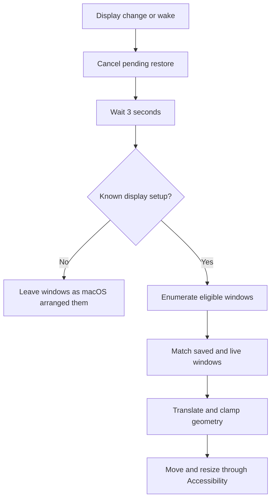

# Technical design and principles

## Goal and boundaries

ScreenMate remembers window positions and sizes for a physical display setup. The core scenario is a MacBook moving between home, work, and its built-in screen, with different combinations of external monitors.

The implementation uses public macOS APIs and local files. It does not try to restore an entire desktop session: launching apps, reopening documents, changing Spaces, reordering windows, and restoring native full-screen spaces are outside the current scope.

## Components

| Component | Responsibility |
| --- | --- |
| `LayoutCore` | Codable snapshots, display-setup keys, geometry conversion between saved/current displays, conservative window matching, local storage and migration |
| `Localization` | 15 language catalogs, persistent language override, system-language selection, English fallback |
| `AppDelegate` | Menu bar UI, application lifecycle, display notifications, restore debounce, auto-save timer, login item registration |
| `WindowService` | Display discovery, Accessibility permission checks, window enumeration, movement and resizing |
| `LayoutStore` | Local JSON loading, atomic writes, deletion, protection against overwriting unreadable files |
| Build scripts | Native/universal builds, resource embedding, icon generation, ad-hoc signing, ZIP/checksum creation |



## Display identity and setup selection

`WindowService.displays()` enumerates `NSScreen` objects, reads their Core Graphics display identifiers, and obtains persistent display UUIDs using `CGDisplayCreateUUIDFromDisplayID`. The transient numeric display ID is not persisted as the identity.

The layout key is a sorted concatenation of each display's UUID and logical width/height:

```text
UUID-A:1512x982|UUID-B:2560x1440
```

Sorting makes enumeration order irrelevant. Display names are labels only. Two monitors of the same model normally expose different UUIDs, but duplicate or changing system identities can still occur with particular hardware or adapters. The app cannot infer home versus work when macOS presents identical identities and dimensions.

The built-in display participates like any other display. Therefore laptop-only, laptop plus monitor A, laptop plus monitor B, and laptop plus A and B are independent setups. Disconnecting all external monitors restores the laptop-only layout if one was previously saved. Closing the lid changes the active set and can require another saved layout.

Display origins are excluded from the saved-layout key. A monitor moved to the left or above another monitor should retain its own windows. Origins are included in the runtime configuration fingerprint so rearranging screens still triggers restoration. Logical resolution is included in the key, so changing display scaling selects a separate layout rather than guessing how to scale windows.

## Window capture

The app enumerates regular running applications through `NSWorkspace`, excluding ScreenMate itself. For each app, it requests its Accessibility windows with a 0.2-second messaging timeout. Unsupported or unresponsive apps are skipped on an attribute failure rather than terminating capture.

Only standard windows and dialogs with readable position and size are included. Minimized and native full-screen windows are excluded. A snapshot stores:

- Application bundle identifier.
- Window title and Accessibility identifier, if supplied by the application.
- UUID of the display containing the largest part of the window.
- Global position and dimensions in logical points.

These attributes do not provide a universal durable identity across application restarts. The matching policy handles that uncertainty explicitly.

Before saving, the app records the current display fingerprint and verifies it again after capture. A changed setup aborts the save. Empty captures do not replace a saved layout.

## Matching saved windows to live windows

Matching only compares windows from the same application bundle identifier. Candidate pairs receive these priorities:

1. Equal, nonempty Accessibility identifiers that are unique within that application in both snapshots.
2. Equal, nonempty titles that are unique within that application in both snapshots.
3. Application-only fallback when exactly one unmatched saved window and one unmatched live window remain for that app.

Candidates are processed from strongest to weakest. Each saved/live window can be consumed once. Duplicate generic identifiers cannot override distinct title matches. Multiple indistinguishable windows are skipped.

Closed applications and missing windows are not errors and are not reopened. Newly opened applications absent from the snapshot are untouched. A new window in a saved app can match a saved window, particularly through the one-to-one fallback; this is a deliberate convenience tradeoff rather than document/session restoration.

## Coordinate systems and geometry

Accessibility uses global coordinates with the origin at the top-left of the primary screen. AppKit uses a bottom-left coordinate system. Core Graphics display bounds already align with the Accessibility orientation.

The app converts `NSScreen.visibleFrame`, which excludes the menu bar and Dock, into Accessibility coordinates using the primary display height:

```text
visibleTop = primaryDisplayHeight - appKitVisibleFrame.maxY
```

Negative coordinates are valid for screens positioned left of or above the primary display.

Restoration preserves a window's offset from its saved display's visible origin and applies that offset to the same physical display's current visible origin. Window dimensions are preserved in logical points, limited to the current visible width and height. Position is clamped so the target rectangle stays inside the visible area.

The Accessibility write sequence is position → size → position. Moving first helps with cross-display constraints; moving again accounts for size adjustments. Applications can reject writes, enforce minimum sizes, or reposition windows themselves. The displayed restored count reflects successful API writes, not an independent visual verification of final geometry.

## Events and timing

`NSApplication.didChangeScreenParametersNotification` triggers a configuration comparison. Changes to the runtime fingerprint schedule restoration; repeated changes cancel the previous pending operation. The debounce is three seconds. Waking from sleep also schedules restoration. Subsequent launches restore the current setup when auto-restore is enabled; first launch displays onboarding instead.

A generation counter protects against stale work. Manual save/restore actions and disabling automatic restoration cancel pending automatic restoration. Auto-save pauses for 12 seconds after a display/wake transition or manual restore.

Optional auto-save runs every 15 seconds and only updates previously saved setups. It is disabled by default to preserve deliberate user preferences. If enabled, it is a rolling snapshot and may drop closed windows from that setup; it is not a history or backup system.

AppKit and Accessibility work currently run on the main thread. The per-application messaging timeout bounds individual IPC waits, but large numbers of unresponsive apps can still delay the menu. Moving capture to a serialized worker with generation checks is a possible later improvement.

## Persistence and privacy

Layouts are stored as a JSON dictionary keyed by display setup in `~/.screenmate/layouts.json`. `Layout`, `Display`, `SavedWindow`, and `Rect` are Codable. `LayoutStore` prepares a replacement dictionary, writes it atomically, and only then updates in-memory state.

On first run, if the new file is absent, a valid legacy file at `~/Library/Application Support/ScreenMate/layouts.json` is copied atomically to the hidden directory, retaining the original as a backup. An existing new file always takes precedence, even if unreadable. The hidden directory is created with owner-only permissions (`0700`). Empty but valid new storage prevents deleted profiles from being reimported.

An unreadable or undecodable file produces an error and blocks later writes. This prevents a failed load from silently destroying an existing layout file. Recovery is manual: quit, back up/move the file, and restart.

The current format has no explicit schema version. Future incompatible changes require versioning and a migration before changing the stored shape. Preferences such as language and auto-restore use `UserDefaults` under the app's bundle identity.

Window titles can contain document names. No layout data is uploaded; the app contains no network client, accounts, telemetry, or analytics. Files rely on normal macOS user-account protections and are not separately encrypted.

## Localization and packaging

English is the default UI language. Users can choose among 15 interface languages or system-language selection from the menu. Arabic onboarding uses right alignment; long headings and body text wrap within the content width. The preference persists. Menus rebuild when opened; an open welcome window is rebuilt when the language changes. Dates use the selected language's locale. Missing translations fall back to English. System-provided error details may remain in the OS language.

SwiftPM processes the `.lproj` resources into `ScreenMate_Localization.bundle`. The packaging script embeds this bundle under the app's `Contents/Resources`; copying only the executable is insufficient. The packaged app's `--check-resources` mode verifies localizations and its `.icns` without displaying a UI or requesting permissions.

Universal releases compile arm64 and x86_64 executables separately and combine them with `lipo`. The app uses an ad-hoc signature and stable bundle identifier. Developer ID signing/notarization is a future distribution improvement and requires appropriate Apple credentials.

## Validation and next steps

Unit tests exercise setup identity, negative-coordinate geometry, clamping, matching order, duplicate identifiers, JSON round trips, and localization parity/fallback/formatting. Packaging checks signatures, architectures, and resources. Real monitor hot-plug and application Accessibility compatibility need the [manual checklist](TESTING.md).

Useful future improvements include named manual profiles for identity collisions, per-window exclusions, an explicit storage schema/migrations, and better handling of delayed application responses. These are not promises of current behavior.

## API references

- [Apple: display configuration changes](https://developer.apple.com/documentation/appkit/nsapplication/didchangescreenparametersnotification)
- [Apple: Accessibility position attribute](https://developer.apple.com/documentation/applicationservices/kaxpositionattribute)
- [Apple: setting Accessibility attribute values](https://developer.apple.com/documentation/applicationservices/1460434-axuielementsetattributevalue)

## Presentation modes and transition overlay

The `showsMenuBarIcon` preference defaults to true. With it enabled, the app uses accessory activation and a visible status item. Hiding the status item switches activation to regular mode, retaining the Dock icon as a persistent settings entry point. `applicationShouldHandleReopen` brings Settings forward, and closing the last window never terminates the background process. Open Controls exposes the same menu from Settings, so saving, restoring, and preferences remain reachable in either mode.

`DisplayToast` owns a borderless, nonactivating, mouse-transparent panel. Actual display fingerprint changes show a three-second progress indicator, and restoration updates the result text. Results fade out after two seconds; an eight-second dismissal is also scheduled when showing the overlay. Repeated changes replace the panel and cancel stale timers/dismissals using a generation counter. The overlay does not move or raise user windows. `showsDisplayToast` defaults to true and can disable the panel independently of automatic restoration. As with restoration, timers run on the main thread, so a blocked Accessibility operation can delay visual updates until control returns.
